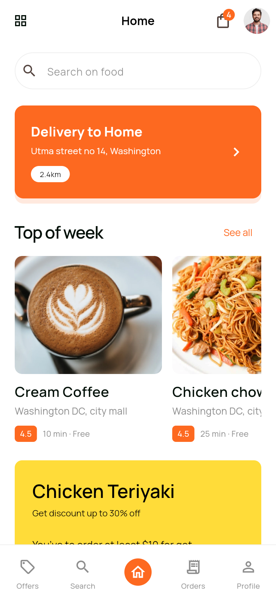
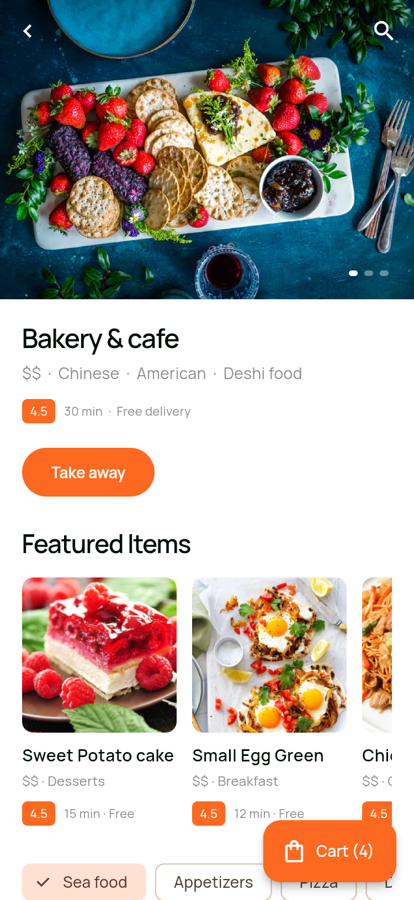
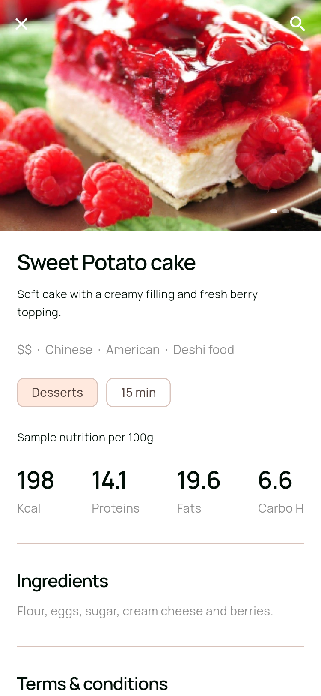
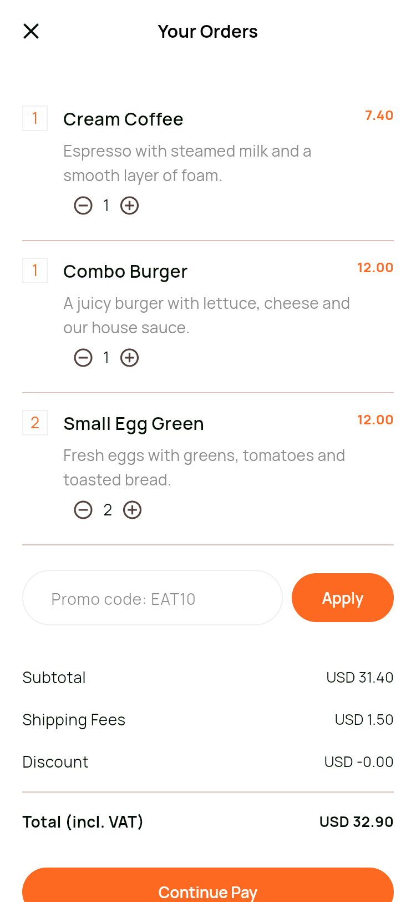
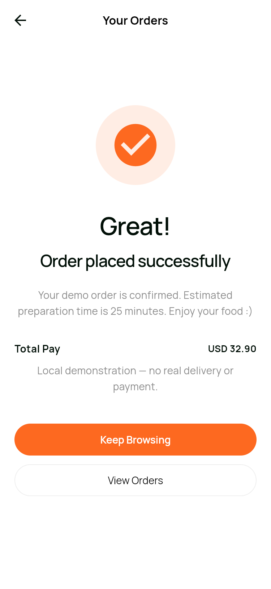
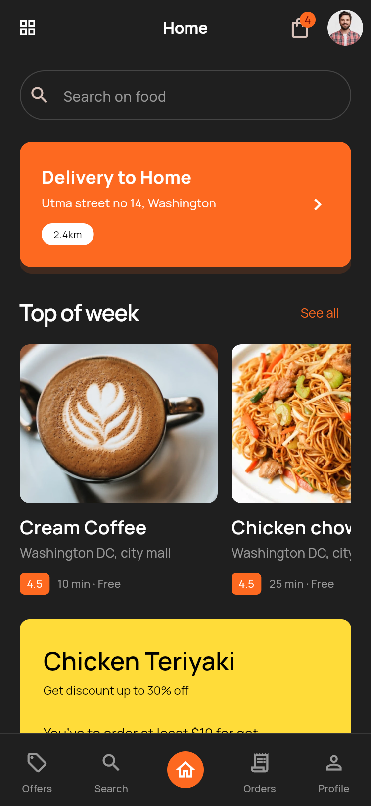

# Eateries · Flutter 美食外卖 App

当前版本：**1.1.0**。

基于 Pixso 文件 **Eateries food app ui kit** 开发的 Flutter UI 演示项目。通过 Refore Talk to Pixso China MCP 读取设计：Light Mode（页面 ID 0:1）与 Dark Mode（页面 ID 7:5191），每组 48 个编号画面。原文件只读，未改动设计稿。

保留橙色主色、Manrope 字体、圆角按钮、食物摄影、引导插画及页面信息层级。采用原生 Flutter 组件实现，可滚动、输入、选择与导航；不是将整张设计稿作为页面背景。

## 界面预览

以下为实际 Flutter 页面截图。完整 96 张见 [全部界面截图](docs/SCREENSHOTS.md)，Android 模拟器截图单独列出。

| 首页 | 餐厅菜单 | 菜品详情 |
| --- | --- | --- |
|  |  |  |

| 购物车 | 下单结果 | 深色首页 |
| --- | --- | --- |
|  |  |  |

## 功能与使用

首次启动进入三步引导。完成演示登录后选择地址，进入首页。**首页左上角四宫格**可打开 48 个页面的目录，目录右上角可切换主题；个人中心也有 Dark Mode 开关。首页及搜索页右上角的购物袋可直接返回购物车。

- **登录注册**：邮箱格式、密码长度与确认密码校验；找回密码预览；手机号与演示验证码流程。
- **发现与搜索**：首页四种编排、精选商家两种编排、餐厅列表、分类、最近搜索、列表/网格结果、空结果状态。
- **筛选**：分类、价格上限、推荐/热度/配送速度/价格排序；清空筛选、应用筛选。
- **点餐**：餐厅菜单、菜品详情、营养信息、配料选项、数量增减、购物车与优惠码。
- **结算与订单**：支付方式选择、测试卡表单、金额计算、本地下单结果、历史订单及再次购买。
- **账户**：资料修改、地址修改、通知偏好、主题、社交偏好、邀请分享预览、可搜索和展开的 FAQ。
- **演示会话**：勾选 Remember me 后保存演示登录状态；不勾选则重启回到登录。退出清除会话和返回栈。
- **本地保存**：资料、地址、购物车、订单、主题、通知与社交偏好、最近搜索使用 SharedPreferences 保存。实际卡号与密码不保存。

### 演示输入

| 内容 | 输入 |
| --- | --- |
| 邮箱登录 | 任意有效邮箱 + 至少 8 位密码 |
| 手机验证码 | 1234 |
| 优惠码 | EAT10，商品小计减 10% |
| 测试卡 | 4242 4242 4242 4242 |
| 测试到期日/CVC | MM/YY 格式 / 3 位测试数字 |
| 默认配送费 | USD 1.50，空购物车为 0 |

**这是本地 UI 与交互演示，不包含服务端。** 登录不会创建真实账户，验证码与邮件不会发送；结算不扣款、不配送，通知开关不请求系统推送权限，社交与分享按钮不连接或发布到第三方账户。定位按钮使用演示地址，不读取设备 GPS。上架前需要接入真实鉴权、商品、支付、地图与订单服务。

## 项目结构

~~~text
EatriesFoodDelivery/
├─ lib/
│  ├─ main.dart                  # 正式入口：恢复本地状态
│  ├─ app.dart                   # 应用主题、页面分发、返回与页面目录
│  ├─ core/
│  │  ├─ app_controller.dart     # 商品/订单模型、状态、金额与持久化
│  │  ├─ screen_catalog.dart     # Pixso 48 个编号画面
│  │  └─ theme.dart              # 统一深浅色主题和控件样式
│  ├─ shared/
│  │  └─ widgets.dart            # 字体层级、按钮、表单、图片、卡片和底栏
│  └─ features/
│     ├─ auth.dart              # 01–14：引导、认证、地址
│     ├─ discover.dart          # 15–20、26–34、48：发现与筛选搜索
│     ├─ orders.dart            # 21–25、35–37：菜单、加购、结算、订单
│     └─ account.dart           # 38–47：账户、支付偏好、邀请与帮助
├─ assets/
│  ├─ images/                   # 从 Pixso 节点导出的插画和照片，压缩为 WebP
│  └─ fonts/                    # Manrope 字体和 OFL 许可
├─ android/                     # Android 工程、应用图标
├─ web/                         # Flutter Web 容器
├─ test/                        # 业务、交互和 96 个画面的布局检查
├─ integration_test/            # Android 下单流程与截图测试
├─ test_driver/                 # 将 Android 截图写回电脑
├─ tool/
│  ├─ preview.dart              # 截图专用入口：固定演示数据
│  ├─ capture_screens.py        # 首屏、长页面截图与预览板
│  ├─ web_tests.py              # Windows 测试资源路径兼容辅助
│  └─ package_release.py        # 安装包、便携源码和校验值
├─ docs/
│  ├─ DESIGN_MAPPING.md         # 原稿节点与代码模块对应表
│  ├─ SCREENSHOTS.md            # 96 个界面的逐页截图索引
│  ├─ VALIDATION.md             # 验证结果、边界与交付说明
│  ├─ design/                  # MCP 节点清单、文字、主要原稿参考图
│  └─ screenshots/             # light、dark、android
└─ pubspec.yaml
~~~

### 架构

~~~mermaid
flowchart TD
  A[main.dart 恢复本地状态] --> B[EateriesApp 主题]
  B --> C[AppShell 页面分发]
  C --> D[Auth / Discover / Orders / Account]
  D --> E[AppController ChangeNotifier]
  E --> F[SharedPreferences 本地存储]
  E --> B
  D --> G[共享组件与主题]
~~~

按业务划分四个页面模块，不为深色主题或每个表单状态复制一套页面。AppController 负责业务状态与运算，页面负责布局和输入，shared/widgets.dart 负责通用组件。使用 Flutter 自带 ChangeNotifier/ListenableBuilder，避免为本地演示引入额外路由、状态管理与网络框架。运行时第三方依赖仅 shared_preferences。

页面编号是轻量导航状态，history 栈处理返回；不是服务端路由。新业务接入时可将 AppController 的示例数据与持久化方法拆为 Repository，再增加 API 实现。金额规则与 UI 分离，已有测试约束。

## 运行

本项目在 Windows 上使用 Flutter 3.47.7 / Dart 3.13.5 验证；Android 模拟器为 API 35、x86_64。当前生成的平台为 Android 和 Web，未验收 iOS。

~~~powershell
flutter pub get
flutter run -d emulator-5556
~~~

正式运行 Web：

~~~powershell
flutter run -d chrome
~~~

生成 Android 安装包（请在集成测试完成后单独执行，避免共享生成文件被测试构建覆盖）：

~~~powershell
flutter build apk --release --target lib/main.dart --target-platform android-arm64,android-x64 --split-per-abi
~~~

完成 Release 构建后运行 `python tool/package_release.py`，重新生成交付文件与 SHA-256。

构建输出位置以 Flutter 终端打印为准。交付副本集中放在 artifacts/ 目录。Android 使用开发签名，供本地安装演示；发布应用商店需替换为自己的签名。

## 验证与截图复现

测试辅助需要 Python 的 playwright 和 psutil 包，以及本机 Chrome。Windows 当前 Flutter 工具的浏览器测试资源路径存在兼容问题，web_tests.py 只将其测试浏览器的 CanvasKit 请求映射到已安装 SDK 的本地资源，并为测试加载项目字体，不改动 SDK 或个人浏览器。

~~~powershell
python -m pip install playwright pillow psutil
flutter analyze
python tool/web_tests.py
flutter drive --driver=test_driver/integration.dart --target=integration_test/app_test.dart -d emulator-5556
~~~

截图使用独立入口，固定购物车和示例订单，仅用于文档；正式入口不会注入这些数据。96 张截图为真实 Flutter Web 渲染，逻辑尺寸 375 × 812、2 倍像素。除 96 张首屏截图外，另补充首页、菜单、详情和账户页的深浅色长布局图；Android 原生运行截图另存。长图通过加高 Flutter 视口生成，便于查看完整内容。

~~~powershell
flutter build web --release --target tool/preview.dart --no-web-resources-cdn
python -m pip install playwright pillow psutil
python tool/capture_screens.py
~~~

截图脚本使用本机 Chrome，自动在 127.0.0.1:8765 启动临时服务并在完成后关闭。Chrome 路径可在脚本中修改。

## 与静态原稿的适配

1. 48 个编号包含同一页面的不同状态或排版，代码按业务页面族复用，不代表 48 个互不相关的业务。
2. 原稿中的 USD/IDR 混合金额统一为 USD，并以购物车实际数据计算；列表使用 8 个示例商品，展示数量与“80 results”等静态占位数不做虚假绑定。
3. 英文拼写作了必要修正；键盘使用系统输入法，不将设计稿的静态键盘绘制进页面。
4. 为可操作性增加页面目录、主题入口、空购物车/空搜索与演示功能说明。
5. 筛选页、成功提示与支付卡片保留原稿信息与配色，但按可用组件重新排版；不是逐像素复刻。具体以源码与运行截图为准。
6. 原稿素材与字体在本地随包加载，正常运行不需要图片网络请求。素材使用范围应遵循原 UI Kit 的授权；字体许可见 assets/fonts/OFL.txt。

第二轮修改详见 [更新记录](docs/CHANGELOG.md)。

记录日期：2026-10-31。

