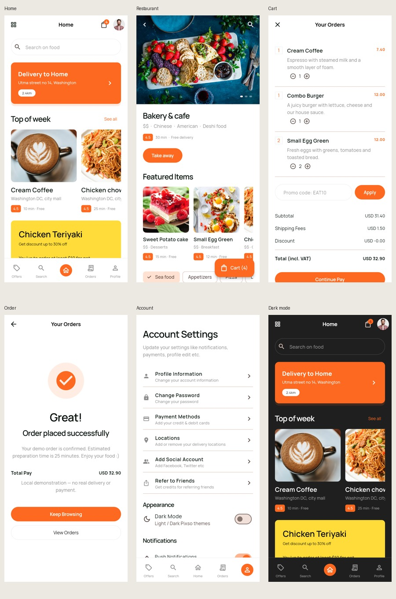
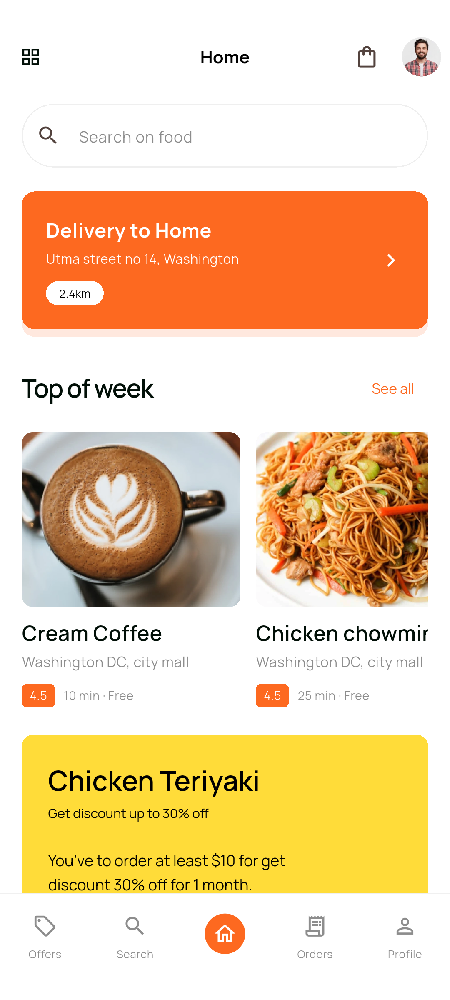
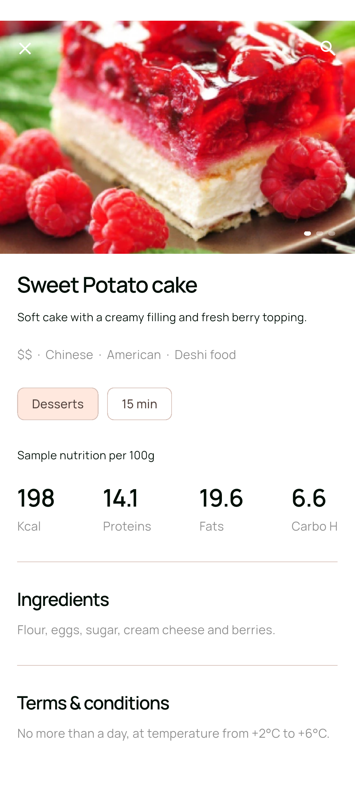
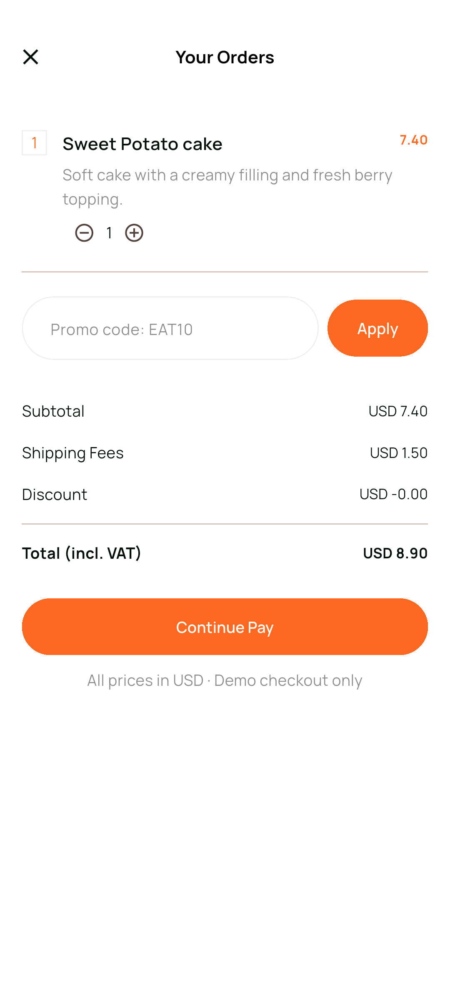
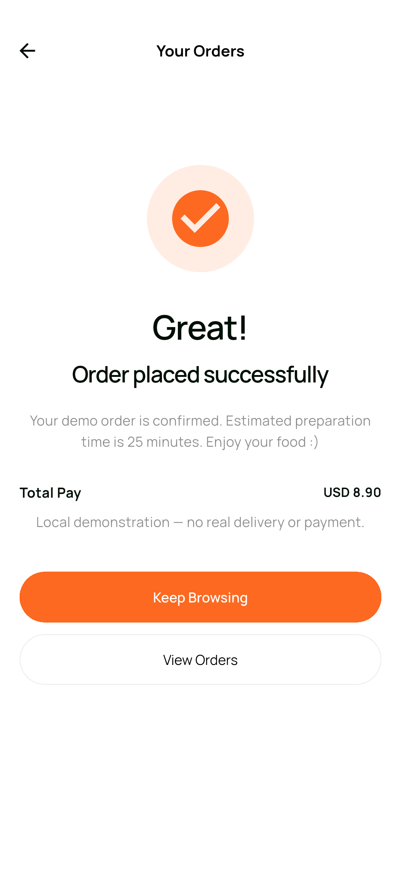
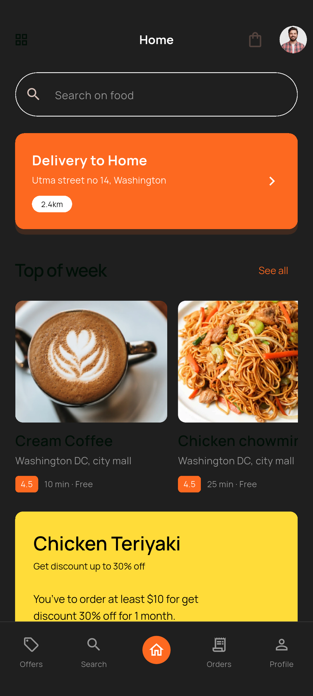

# 全部界面截图

以下 **96 张**为真实 Flutter Web 界面截图，48 个编号 × 浅色/深色。采用固定演示数据，逻辑视口 375 × 812，导出像素 750 × 1624。长页面记录首屏，App 内可以继续滚动。原稿参考图在 design/，不是本目录的运行截图。

## 主要界面总览

## Android 模拟器

模拟器 API 35 / x86_64；下单流程与主题切换经集成测试。下列为 Android 原生运行截图，不是套手机外框的渲染图。

| 首页 | 菜品 | 购物车 |
| --- | --- | --- |
|  |  |  |

| 下单结果 | 深色首页 |
| --- | --- |
|  |  |

另附 [Release 安装包启动截图](screenshots/android/01-onboarding-release.png)。

另附 [退出登录状态](screenshots/android/04-logged-out.png) 与 [Android 价格筛选](screenshots/android/28-price.png)。

## 长页面补充

以下通过加高 Flutter 视口生成，展示菜单和表单的完整布局；并非单个手机首屏截图。

| 页面 | 浅色长图 | 深色长图 |
| --- | --- | --- |
| 首页 | [查看](screenshots/long/light-15.png) | [查看](screenshots/long/dark-15.png) |
| 餐厅菜单 | [查看](screenshots/long/light-21.png) | [查看](screenshots/long/dark-21.png) |
| 菜品详情 | [查看](screenshots/long/light-23.png) | [查看](screenshots/long/dark-23.png) |
| 账户设置 | [查看](screenshots/long/light-38.png) | [查看](screenshots/long/dark-38.png) |

## 逐页索引

| 编号 | 页面 | 浅色 | 深色 |
| --- | --- | --- | --- |
| 01 | Splash Screen 1 | [查看](screenshots/light/01.png) | [查看](screenshots/dark/01.png) |
| 02 | Splash Screen  2 | [查看](screenshots/light/02.png) | [查看](screenshots/dark/02.png) |
| 03 | Splash Screen  3 | [查看](screenshots/light/03.png) | [查看](screenshots/dark/03.png) |
| 04 | Sign in 1 | [查看](screenshots/light/04.png) | [查看](screenshots/dark/04.png) |
| 05 | Sign in 2 | [查看](screenshots/light/05.png) | [查看](screenshots/dark/05.png) |
| 06 | Forgot password | [查看](screenshots/light/06.png) | [查看](screenshots/dark/06.png) |
| 07 | Reset email | [查看](screenshots/light/07.png) | [查看](screenshots/dark/07.png) |
| 08 | Sign in 3 | [查看](screenshots/light/08.png) | [查看](screenshots/dark/08.png) |
| 09 | Sign up  1 | [查看](screenshots/light/09.png) | [查看](screenshots/dark/09.png) |
| 10 | Sign up  2 | [查看](screenshots/light/10.png) | [查看](screenshots/dark/10.png) |
| 11 | Login by Phone number | [查看](screenshots/light/11.png) | [查看](screenshots/dark/11.png) |
| 12 | Confirm phone number | [查看](screenshots/light/12.png) | [查看](screenshots/dark/12.png) |
| 13 | Enter adress | [查看](screenshots/light/13.png) | [查看](screenshots/dark/13.png) |
| 14 | Type locations | [查看](screenshots/light/14.png) | [查看](screenshots/dark/14.png) |
| 15 | home page 1 | [查看](screenshots/light/15.png) | [查看](screenshots/dark/15.png) |
| 16 | home page 2 | [查看](screenshots/light/16.png) | [查看](screenshots/dark/16.png) |
| 17 | home page 3 | [查看](screenshots/light/17.png) | [查看](screenshots/dark/17.png) |
| 18 | home page 4 | [查看](screenshots/light/18.png) | [查看](screenshots/dark/18.png) |
| 19 | Featue partner 1 | [查看](screenshots/light/19.png) | [查看](screenshots/dark/19.png) |
| 20 | Featue partner 2 | [查看](screenshots/light/20.png) | [查看](screenshots/dark/20.png) |
| 21 | Single resturent 1 | [查看](screenshots/light/21.png) | [查看](screenshots/dark/21.png) |
| 22 | Single resturent 2 | [查看](screenshots/light/22.png) | [查看](screenshots/dark/22.png) |
| 23 | add to order | [查看](screenshots/light/23.png) | [查看](screenshots/dark/23.png) |
| 24 | your order | [查看](screenshots/light/24.png) | [查看](screenshots/dark/24.png) |
| 25 | add payment method | [查看](screenshots/light/25.png) | [查看](screenshots/dark/25.png) |
| 26 | Filters/food type 1 | [查看](screenshots/light/26.png) | [查看](screenshots/dark/26.png) |
| 27 | Filters/food type 2 | [查看](screenshots/light/27.png) | [查看](screenshots/dark/27.png) |
| 28 | Filters/food type 3 | [查看](screenshots/light/28.png) | [查看](screenshots/dark/28.png) |
| 29 | Filters/food type 4 | [查看](screenshots/light/29.png) | [查看](screenshots/dark/29.png) |
| 30 | Search Restaurants | [查看](screenshots/light/30.png) | [查看](screenshots/dark/30.png) |
| 31 | Search food | [查看](screenshots/light/31.png) | [查看](screenshots/dark/31.png) |
| 32 | Searching food | [查看](screenshots/light/32.png) | [查看](screenshots/dark/32.png) |
| 33 | Search results 1 | [查看](screenshots/light/33.png) | [查看](screenshots/dark/33.png) |
| 34 | Search results 2 | [查看](screenshots/light/34.png) | [查看](screenshots/dark/34.png) |
| 35 | Your orders | [查看](screenshots/light/35.png) | [查看](screenshots/dark/35.png) |
| 36 | Your orders | [查看](screenshots/light/36.png) | [查看](screenshots/dark/36.png) |
| 37 | Order msg | [查看](screenshots/light/37.png) | [查看](screenshots/dark/37.png) |
| 38 | Account settings | [查看](screenshots/light/38.png) | [查看](screenshots/dark/38.png) |
| 39 | Profile settings | [查看](screenshots/light/39.png) | [查看](screenshots/dark/39.png) |
| 40 | Change password | [查看](screenshots/light/40.png) | [查看](screenshots/dark/40.png) |
| 41 | Payment method | [查看](screenshots/light/41.png) | [查看](screenshots/dark/41.png) |
| 42 | Card list | [查看](screenshots/light/42.png) | [查看](screenshots/dark/42.png) |
| 43 | Locations | [查看](screenshots/light/43.png) | [查看](screenshots/dark/43.png) |
| 44 | Add social accounts | [查看](screenshots/light/44.png) | [查看](screenshots/dark/44.png) |
| 45 | Refer to friends | [查看](screenshots/light/45.png) | [查看](screenshots/dark/45.png) |
| 46 | Share link/Popup | [查看](screenshots/light/46.png) | [查看](screenshots/dark/46.png) |
| 47 | FAQS | [查看](screenshots/light/47.png) | [查看](screenshots/dark/47.png) |
| 48 | Browse foods | [查看](screenshots/light/48.png) | [查看](screenshots/dark/48.png) |

重新生成方法见 [README](../README.md)。

